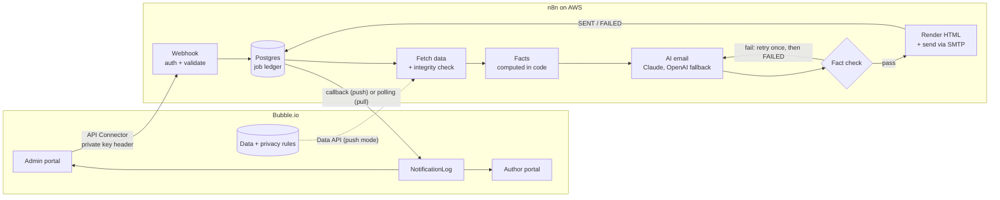

# BookLeaf Author Royalty Dashboard & Automated Notifications

A Bubble.io app where authors see their books and royalties, and admins send each author a
personalised royalty email with one click. An n8n workflow does the work behind the button: it
reads the author's data, has an AI write the email, **checks every number in it**, sends it, and
reports Sent or Failed back to Bubble.

## Try it

| | |
|---|---|
| Live app | {{LIVE_URL}} |
| Author login | {{AUTHOR_LOGIN}} |
| Admin login | {{ADMIN_LOGIN}} |
| Video (3-5 min) | {{VIDEO_URL}} |
| n8n (read-only) | {{N8N_URL}} |

All emails go to one demo inbox. They are never sent to the addresses in the sample data.
Figures are shown as of **31 Dec 2025**, the date the sample data ends. Admins can switch to
today's date in Settings. See [decisions](docs/decisions.md).

## How it fits together



## What's beyond the brief

- **Fact-checked AI emails.** Every figure is computed in code. The AI writes only the prose, and a
  checker scans the finished text. A wrong rupee amount, date, count or percentage is blocked.
  The job fails instead of sending. See [AI prompt strategy](docs/ai-prompt-strategy.md).
- **Durable job ledger.** Every request is a row in Postgres. A unique key (author + data
  fingerprint + 10-minute window) means a double click gives one email.
- **Push and pull modes.** With a Bubble paid plan, n8n reads and writes Bubble directly (push).
  On the free plan, Bubble sends the data and polls for the result (pull). Same workflow, one switch.
- **Failure drills.** Admin switches that break the AI, the email step or the data fetch on
  purpose, so the error paths can be shown live.
- **Workflow as code.** The logic lives in tested modules (unit tests and live contract tests).
  A build script inlines them into the n8n workflow JSON.
- **Status reference date.** Book badges (green, yellow, red) use a set date, not "today".
- **Cost per email tracked.** Tokens and USD are stored on each job and shown in the log.
- **Infrastructure as code.** Terraform and Docker Compose for the n8n server.
- **Never silent.** A crash, a stuck job or a failed callback always ends in a visible state.
  See [error handling](docs/error-handling.md).

## Docs

| Doc | What is in it |
|---|---|
| [docs/schema.md](docs/schema.md) | Bubble database, privacy rules, and why it is shaped this way |
| [docs/integration.md](docs/integration.md) | Bubble to n8n flow, auth, idempotency, push and pull |
| [docs/ai-prompt-strategy.md](docs/ai-prompt-strategy.md) | How the AI is used and kept honest |
| [docs/error-handling.md](docs/error-handling.md) | Every failure, how it is caught, what the user sees |
| [docs/decisions.md](docs/decisions.md) | Why each big choice was made |
| [docs/learning-log.md](docs/learning-log.md) | Problems I hit and how I solved them |
| [n8n/PAYLOAD.md](n8n/PAYLOAD.md) | The webhook contract |

## Screenshots

Expected files in `docs/media/`:

| File | Shows |
|---|---|
| `author-dashboard.png` | KPI tiles and royalty overview with badges |
| `author-books.png` | My Books list |
| `admin-overview.png` | Authors table with filters |
| `admin-author-detail.png` | Author detail with Generate & Send |
| `admin-bulk-send.png` | Bulk send with live progress |
| `notification-log.png` | Log with status, cost, and email preview |
| `email-sample.png` | A finished email in an inbox |
| `n8n-workflow.png` | The royalty-summary workflow canvas |
| `failure-drill.png` | A drill producing a Failed log with a reason |

## Repo map

```
bubble-app/   Bubble database as code (schema.mjs), .bubble export, migration runbook {{VERIFY}}
n8n/src/      Tested logic: validate, integrity, facts, checker, providers, render, cost, bubble-client
n8n/workflows/ Generated workflow JSON (n8n/build.mjs inlines src/ into the nodes)
n8n/tests/    Unit tests
tests/        Contract tests (live webhook) and browser end-to-end scripts
infra/        Terraform (n8n server) and the Postgres job-ledger schema
docker/       Docker Compose for local and server runs
data/         Sample dataset and generated Bubble seed files
scripts/      Seed builder and Bubble editor tooling
docs/         The documents above
PLAN.md TASKS.md   Architecture notes and task ledger
```
