# BookLeaf Author Royalty Dashboard & Automated Notifications

A Bubble.io app where authors see their books and royalties, and admins send each author a
personal royalty email with one click. An n8n workflow does the work behind the button: it checks
the author's data, has an AI write the email, **checks every number in it**, sends it, and Bubble
shows Sent or Failed with the reason.

## Try it

| | |
|---|---|
| Live app | https://bookleaf-royalties-81850.bubbleapps.io/version-test (Bubble free plan; the free plan has no live version, so this is the test version) |
| Author login | `priya.sharma@email.com` (Priya Sharma, AUTH001) |
| Admin login | `admin@bookleaf.demo` |
| Password (all logins) | `TestBookLeaf@123`. The sign-in page also has one-click "Demo author" and "Demo admin" buttons. |
| Video (3-5 min) | {{VIDEO_URL}} |
| Bubble editor access | Tried on 12 Nov: on the free plan, Bubble only lets you invite collaborators after upgrading to the Growth plan (the Invite button stays disabled). As BookLeaf's email allows, the live URL, the two logins above and the video are provided instead. |
| n8n workflows | Self-hosted n8n 2.45.4 on AWS EC2, not n8n Cloud, so there is no shared workspace to open. The 7 workflows are in [`n8n/export/`](n8n/export/), ready to import (see [Setup](#setup--run-it-yourself)). Canvas screenshots are below. |

All emails go to one demo inbox. n8n refuses any other address (422 `RECIPIENT_NOT_ALLOWED`), so
the addresses in the sample data are never emailed. Figures are shown as of **31 Dec 2025**, the
date the sample data ends; admins can switch to today's date in Settings
([decision 4](docs/decisions.md)).

## Screenshots

| | |
|---|---|
| 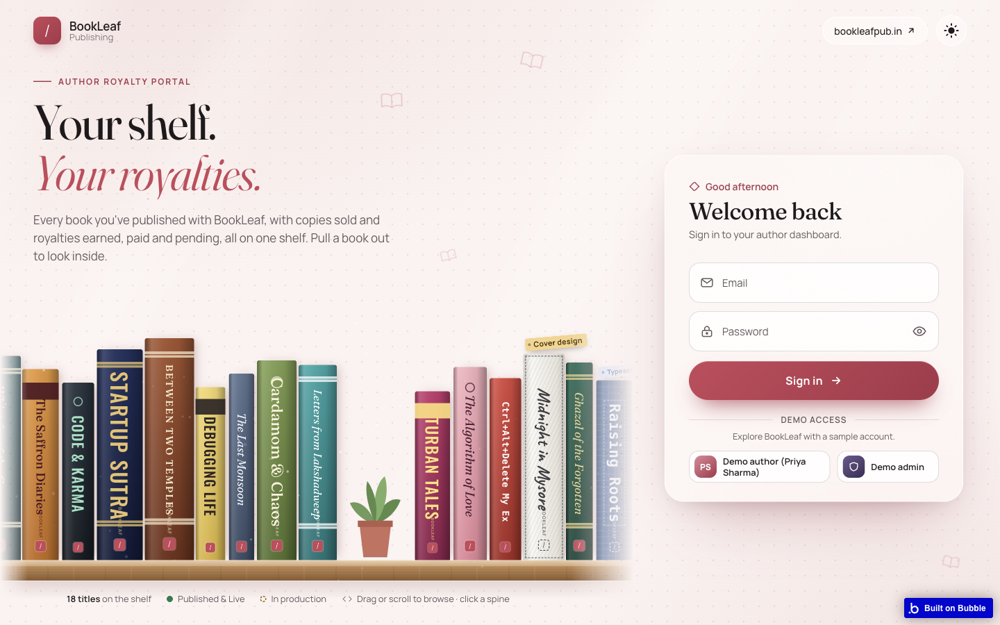 Sign-in: the Living Bookshelf, with one-click demo logins | 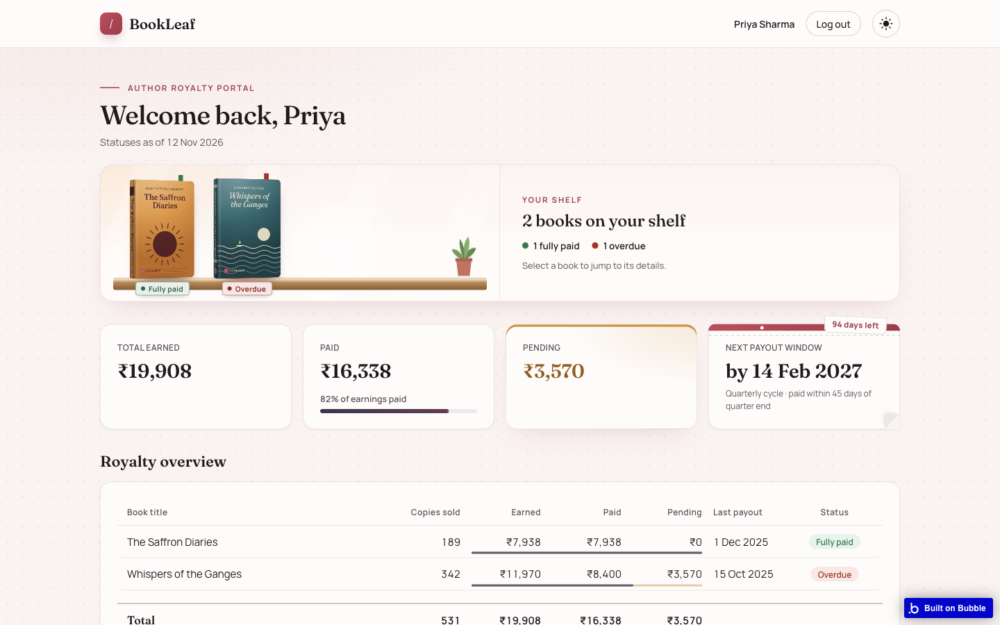 Author: KPI tiles and royalty overview badges |
| 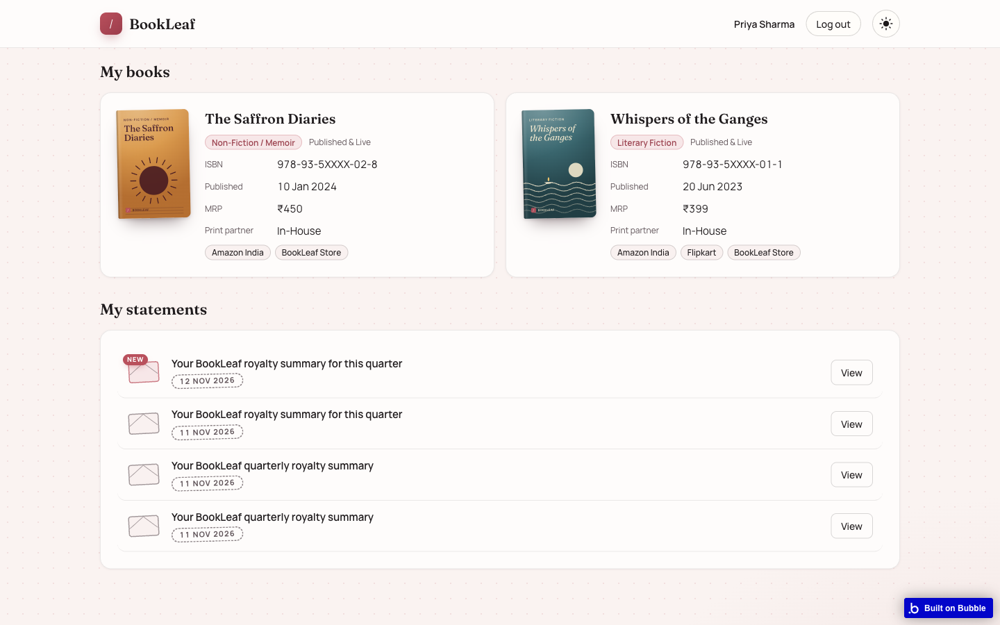 Author: My books and statements | 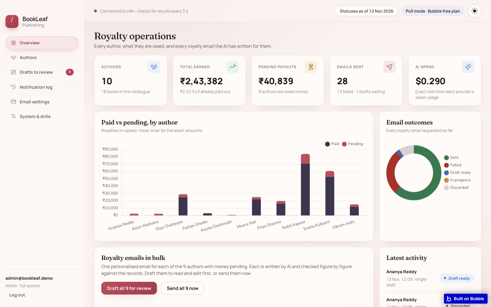 Admin: KPIs, charts, bulk send |
| 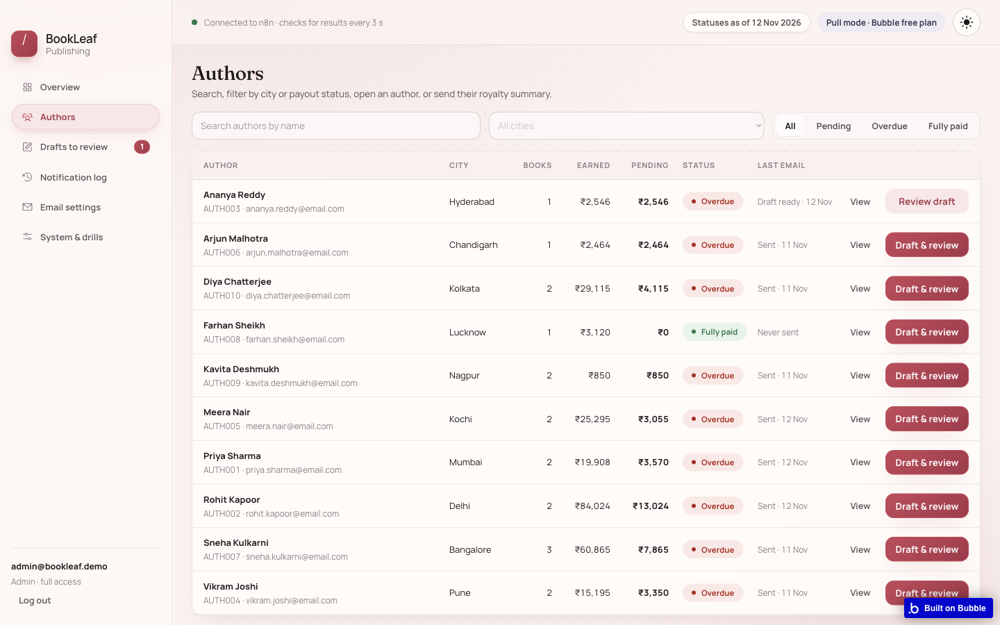 Admin: authors table with filters | 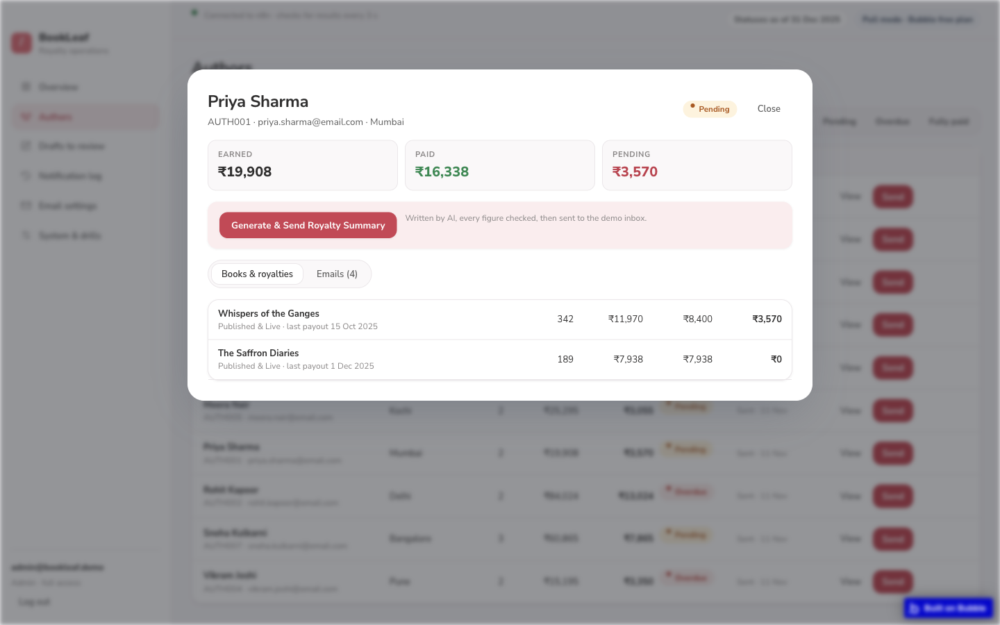 Admin: author drawer with Generate & Send |
| 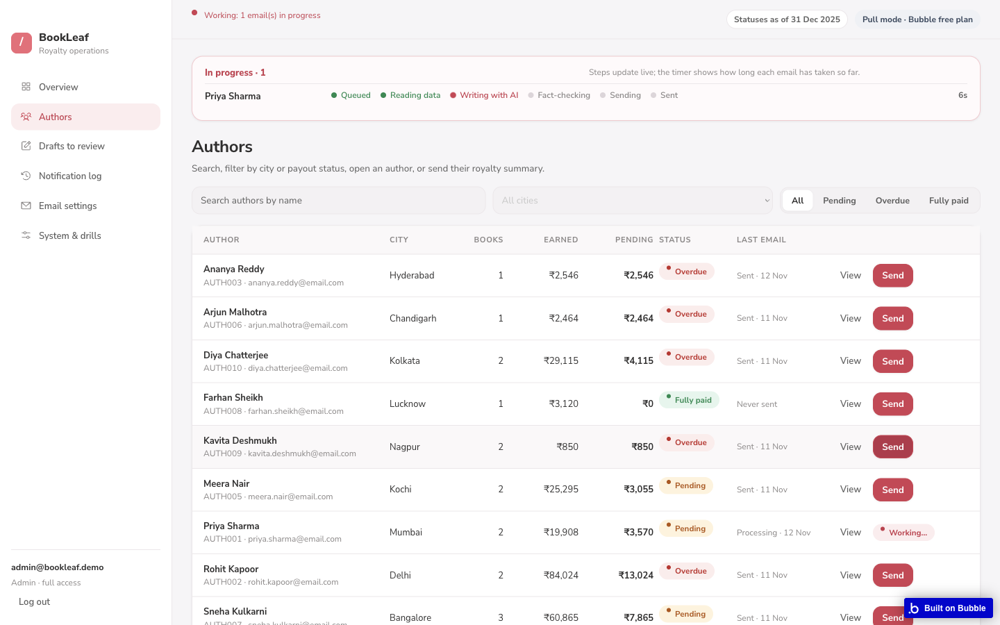 Admin: live progress stepper | 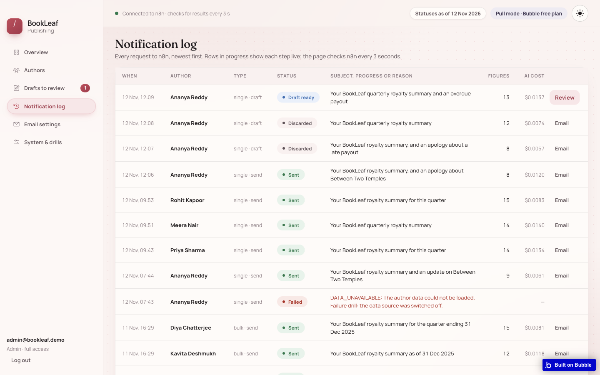 Notification log: status, cost, preview |
| 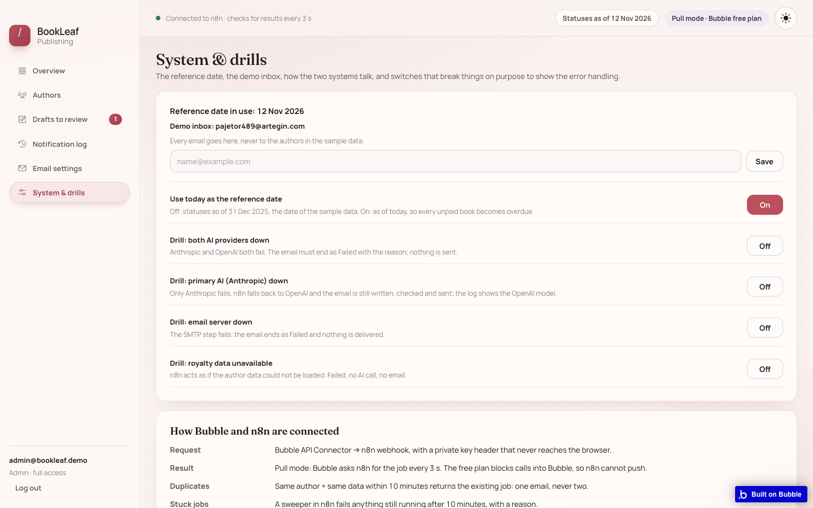 Admin: System & drills | 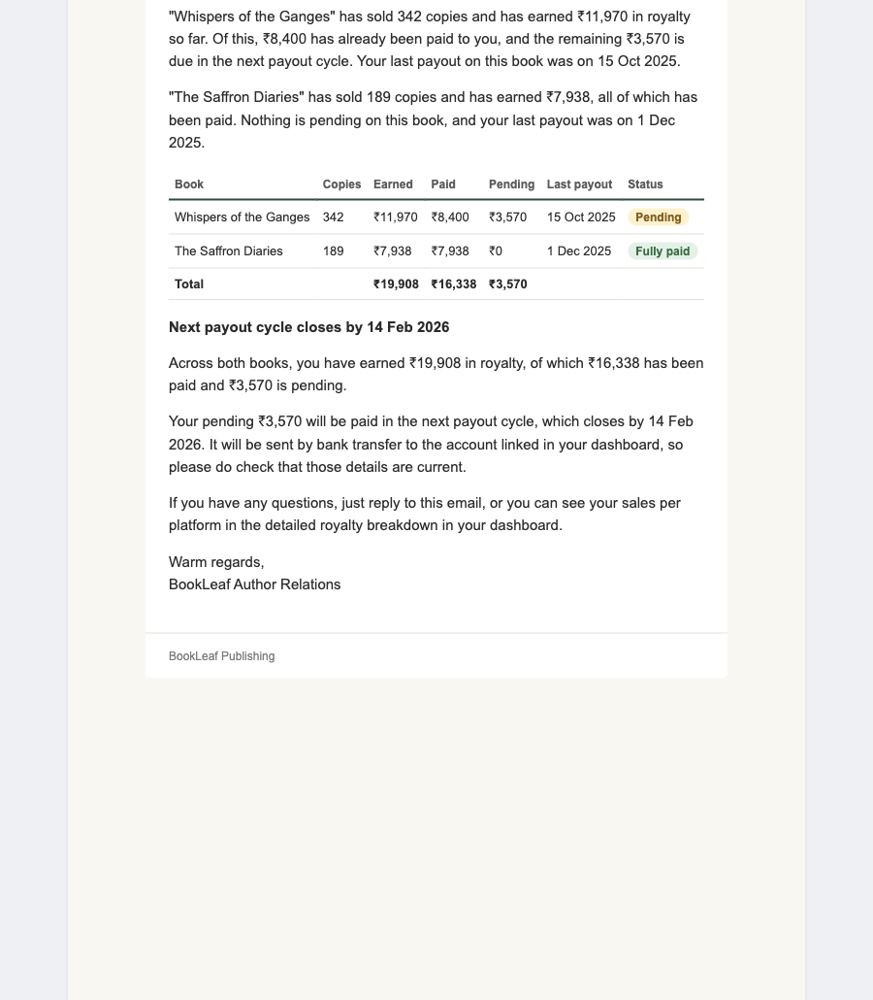 A finished email |
| 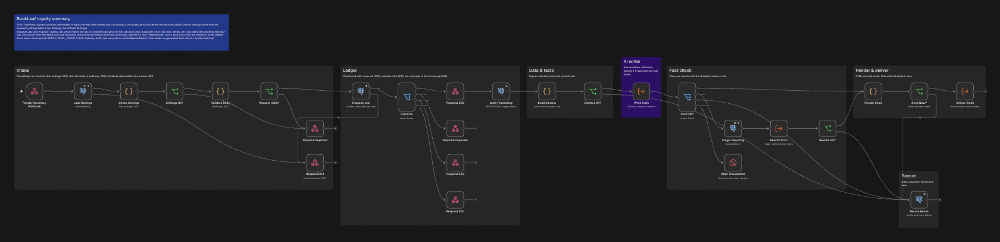 n8n: Royalty Summary canvas | 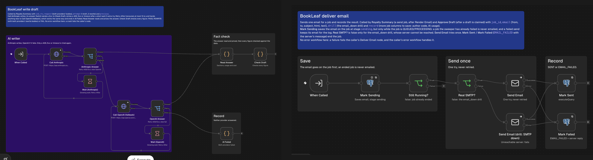 n8n: Write Draft and Deliver Email |

## How it fits together

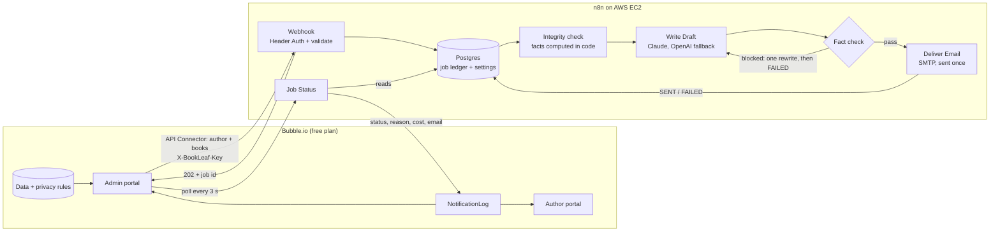

Bubble makes every call. n8n never calls Bubble, because the Bubble free plan blocks all inbound
APIs (see [decision 12](docs/decisions.md)).

## The five topics the brief asks about

**1. Bubble database, and why it is shaped this way.** Five data types: User (with a Role),
Author, Book, RoyaltyRecord and NotificationLog, plus one AppSettings row and six option sets.
Book facts and money are separate types, because royalties change every quarter and the
catalogue does not. Book, RoyaltyRecord and NotificationLog each carry a direct `owner` (the
author's login), so every privacy rule is one comparison, `owner = Current User`. Authors see
only their own rows; admins see everything. A browser test logs in as each of the 10 authors and
fails if another author's book appears. Details: [docs/schema.md](docs/schema.md).

**2. Bubble and n8n integration.** The admin presses Generate & Send. Bubble creates a
NotificationLog row (Queued) and its API Connector posts the author and their books to the n8n
webhook, with the private header `X-BookLeaf-Key` added on Bubble's server. n8n's Header Auth
rejects a missing or wrong key with 403 before any node runs. n8n checks every field, records a
job in Postgres and answers **202 with a job id** at once. Bubble then polls the job-status
webhook every 3 seconds and copies the stage, result, reason and cost onto the log. A double click
gives one email: the Postgres function `enqueue_royalty_job` takes an advisory lock and returns the
first job for the same author and data within `duplicate_window_minutes` (10); `max_sends_per_hour`
(60) caps the volume. Details: [docs/integration.md](docs/integration.md), contract:
[n8n/PAYLOAD.md](n8n/PAYLOAD.md).

**3. AI prompt strategy.** The AI writes words; code owns numbers. Every figure (per book, totals,
next payout date, policy figures from the BookLeaf knowledge base) is computed in code and given
to the model as a list of verified facts. Which case applies (overdue, pending, below the ₹1,000
minimum, all paid, book in production, no sales yet) is decided by code and passed as flags. The
model returns fixed JSON sections. The figures table is rendered from data, not by the AI. A
checker then reads the finished text and blocks any figure, date or percentage that is not a
fact, number words, placeholders, banned phrases, links, phone numbers and unknown email
addresses. One rewrite with the checker's notes, then FAILED. Claude (`claude-sonnet-5-5`) is the
primary writer and OpenAI `gpt-4.1-mini` the fallback. Measured on production on 12 Nov 2026:
53 sent emails, **$0.0085 per email** on average. Details:
[docs/ai-prompt-strategy.md](docs/ai-prompt-strategy.md).

**4. Error handling.** Never silent: every request ends Sent, Failed with a readable reason, or as
a draft waiting for an admin. Bad input gets 400 with the field list; a database outage before
the answer gets 503; AI errors retry only a 429, 5xx or timeout, then fall back to OpenAI; SMTP is
tried once (a retry could email twice); an Error Workflow fails the job a crashed run owned and
emails an alert; a sweeper ends stuck jobs every minute. Admin "drills" break the AI, the email
step or the data on purpose, so each path can be shown live. Details:
[docs/error-handling.md](docs/error-handling.md).

**5. Challenges and the Bubble learning process.** The free plan has no Data API or Workflow
API, so the planned push design was replaced by Bubble sending the data and polling. There is no
way to define a Bubble app in code, so I wrote the schema and the admin page as data and wrote
them into the editor with scripts, then checked the result with tests and a browser run. Bubble
quirks I hit: conditions read as empty, a privacy rule that hid search results, date pickers that
ignore typed text, and a 200-record cap. Details: [docs/learning-log.md](docs/learning-log.md).

## n8n features used

Counts are from the 7 workflows in [`n8n/export/`](n8n/export/).

| Feature | Where |
|---|---|
| Webhook + Header Auth credential ("BookLeaf Webhook Key") | 3 webhooks: `royalty-summary`, `royalty-summary/jobs`, `royalty-summary/approve` |
| Respond to Webhook | 16 nodes: 202, 200 duplicate, 400/422 rejections, 429, 500, 503 and the approve answers |
| Switch (Rules mode, named outputs + fallback) | 5 nodes: the enqueue outcome, the draft check, the approve action, and each AI provider's answer |
| IF | 12 nodes |
| Code | 13 nodes, bundled from tested modules in `n8n/src` by `n8n/build.mjs` |
| Postgres (bound parameters) | 15 nodes: ledger, settings, `enqueue_royalty_job` |
| Execute Workflow (sub-workflows) | Write Draft (called twice: draft, then at most one rewrite) and Deliver Email (called by Royalty Summary and Approve Draft) |
| HTTP Request + Wait | The Anthropic and OpenAI calls, each with a Wait before its one retry |
| Error Workflow | "BookLeaf - Error Handler" finds the job by the failed execution's id |
| Schedule Trigger | "BookLeaf - Stuck Job Sweeper", every minute: stuck jobs become `TIMEOUT` or `EMAIL_UNCERTAIN` |
| Send Email (SMTP) | Deliver Email and the alert |
| Sticky notes | 29, coloured by section (about, AI, failure handling) |
| Settings | 600 s execution timeout; webhook workflows keep no successful run (the request headers hold the key) |

Server settings (17 keys: sender, demo inboxes, models, prices, limits, timeouts) live in the
Postgres table `bookleaf_settings`. n8n blocks `$env` in Code nodes, so no workflow reads it.

## Beyond the brief

- **Fact-checked AI emails**: a wrong rupee amount, date or count blocks the send.
- **Drafts**: an admin can ask for a draft, edit it (the edit is checked again), regenerate it in
  another tone or length, then approve or discard it.
- **Durable job ledger** in Postgres, with an atomic duplicate check and an hourly cap.
- **Live progress**: queued, reading data, writing, fact-checking, sending, shown as a stepper.
- **Cost per email**: tokens and USD stored on each job and shown in the log.
- **Failure drills** that can be switched on from the admin System page.
- **Workflow as code**: logic in tested modules, workflows generated from `n8n/workflows-src/`.
- **Infrastructure as code**: Terraform for the EC2 host, Docker Compose for n8n, Postgres and
  Caddy (HTTPS).
- **CI**: GitHub Actions runs the unit tests, the build check and the ledger SQL tests.

## Tests

| Command | What it checks | Result |
|---|---|---|
| `npm test` | Unit and build tests: facts, checker, prompt, providers, rendering, the built workflows and the export | 616 pass |
| `npm run test:db` | The ledger SQL on a real Postgres 16 | 50 pass |
| `npm run test:contract -- --env <file>` | The live webhooks: auth, validation, sends, drafts, drills, duplicates, error handler | 45 on the local stack; 43 on production (2 are local-only) |
| `node n8n/build.mjs --check` | The committed workflow JSON matches its sources | clean |
| `ego-browser nodejs < tests/e2e/run-author-portal.mjs` | Logs in as each author on the live app: privacy, figures, badges, statements | 10/10 authors |

## Setup / run it yourself

**Import into an existing n8n (tested on 2.45.4)**

1. Create a Postgres 16 database named `bookleaf` and apply
   [`infra/db/init/01-bookleaf.sql`](infra/db/init/01-bookleaf.sql). It creates the job ledger,
   the settings table (with defaults) and `enqueue_royalty_job`.
2. Write your own per-environment settings (sender, demo inbox, alert address, drills):
   `node n8n/tools/settings-sql.mjs --env <your env file> | psql <bookleaf database>`.
   The env file may set `EMAIL_FROM`, `DEFAULT_DEMO_INBOX`, `ALLOWED_DEMO_INBOXES`,
   `ALLOW_DRILLS` and `ALERT_EMAIL`.
3. In n8n, create the credentials with these exact names (import links nodes by name and type):
   `BookLeaf Postgres (bookleaf db)` (Postgres), `BookLeaf SMTP` (SMTP),
   `BookLeaf SMTP (drill: unreachable server)` (SMTP, any closed port, used by the `email_down`
   drill), `BookLeaf Anthropic API (x-api-key)` (Header Auth), `BookLeaf OpenAI API (bearer)`
   (Bearer Auth) and `BookLeaf Webhook Key` (Header Auth on `X-BookLeaf-Key`).
4. `n8n import:workflow --separate --input=n8n/export`, then publish the workflows. Imported
   workflows are inactive until published.

**Local stack (Docker)**

1. Put the SMTP account in `.env` (`SMTP_HOST`, `SMTP_PORT`, `SMTP_SECURE`, `SMTP_USER_EMAIL`,
   `SMTP_USER_PASSWORD`) and the AI keys (`ANTHROPIC_API_KEY`, `OPENAI_API_KEY`) in the `.env` of
   the parent folder, which is where `n8n/deploy.mjs` reads them.
2. `npm ci`, then `node docker/bootstrap.mjs`: starts n8n 2.45.4 and Postgres 16
   (`docker/docker-compose.local.yml`, which applies the init SQL on first start), writes the local
   settings, and creates the n8n owner and an API key in `.secrets/n8n-local.env`.
3. `node n8n/deploy.mjs --env .secrets/n8n-local.env`: creates the credentials and publishes the
   7 workflows.
4. Tests: `npm test`, `npm run test:db`, `npm run test:contract` (sends real emails to the demo
   inbox).

The production host is built with Terraform; see [infra/README.md](infra/README.md).

## Docs

| Doc | What is in it |
|---|---|
| [docs/schema.md](docs/schema.md) | Bubble database, privacy rules, and why it is shaped this way |
| [docs/integration.md](docs/integration.md) | Bubble to n8n flow, auth, duplicates, the n8n workflows and the import-ready export |
| [docs/ai-prompt-strategy.md](docs/ai-prompt-strategy.md) | How the AI is used and kept honest, edge cases, cost |
| [docs/error-handling.md](docs/error-handling.md) | Every failure, how it is caught, what the user sees, the drills |
| [docs/decisions.md](docs/decisions.md) | Why each big choice was made |
| [docs/learning-log.md](docs/learning-log.md) | Problems I hit, what I learned about Bubble, honest lessons |
| [docs/n8n-refactor-notes.md](docs/n8n-refactor-notes.md) | Engineering log of the n8n rebuild, step by step, with review fixes |
| [n8n/PAYLOAD.md](n8n/PAYLOAD.md) | The webhook contract and error codes |

## Repo map

```
bubble-app/          Bubble database as data (schema.mjs) and the admin page as Bubble JSON (admin/)
n8n/src/             Tested logic: validation, integrity, facts, prompt, checker, providers, rendering
n8n/workflows-src/   Workflow sources: nodes and connections of the 7 workflows
n8n/workflows/       Built workflow JSON (n8n/build.mjs bundles src/ into the Code nodes)
n8n/export/          Import-ready copy of the 7 workflows (credential ids removed)
n8n/tools/           Export, settings SQL, n8n API and secret helpers
n8n/tests/           Unit and build tests
n8n/deploy.mjs       Creates the credentials and publishes the workflows through the n8n API
tests/               Contract tests (live webhooks), ledger SQL tests, browser end-to-end check
infra/               Terraform for the n8n host, Postgres init SQL and migrations
docker/              Local n8n + Postgres stack and its bootstrap script
data/                Sample dataset and generated seed files
scripts/             Seed builder, Bubble editor tooling, production migration script
.github/workflows/   CI: unit tests, build check, ledger SQL on Postgres 16
docs/                The documents above, and screenshots in docs/media/
PLAN.md TASKS.md     Architecture notes and task ledger
```
