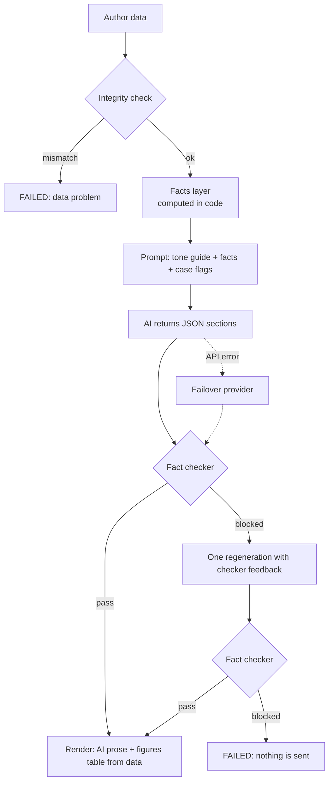

# AI prompt strategy

The rule behind everything here: **the AI writes words. Code owns numbers.** An author must never
get an email with a wrong rupee figure, date or count.

## The pipeline

## 1. Facts first

Before any AI call, code builds a list of facts for the author: per published book (earned,
paid, pending, copies, royalty per copy, MRP, last payout, publication date), the totals, the next
payout date (end of the current quarter + 45 days), the reference date, and policy facts from the
BookLeaf knowledge base (minimum payout of ₹1,000, 45-day window, 80/20 split, 48-hour
escalation, 90-day overdue rule). Money is stored in paise to avoid rounding errors.

Each book also gets a badge computed by code, not by the AI:
- **Green:** nothing pending.
- **Red:** money pending and no payout (or, if never paid, no publication) for more than 90 days
  before the reference date.
- **Yellow:** pending, but not overdue.
- **None:** in production.

Before facts are built, an integrity check looks for bad data: earned must equal copies x rate,
paid + pending must equal earned, in-production books must be all zero, no payout dates in the
future, no duplicate book codes. If the data is wrong, the job fails with the exact reason. We
do not write a confident email from broken numbers.

## 2. Structured output, small surface for the AI

The AI must return JSON with fixed sections: `subject`, `greeting`, `intro`, `bookParagraphs`
(one `{code, text}` per book), `totalsParagraph`, `payoutParagraph`, `closing`, and optional
`productionParagraph` and `allPaidParagraph`. The schema is enforced by the provider's structured
output. Our code checks it again and treats bad JSON, missing sections or a refusal as a failure
of that attempt.

## 3. The figures table is not written by the AI

The table of per-book earned, paid and pending, and the next payout date line, are rendered by
our code straight from the facts. The AI cannot get a number in that table wrong because it never
touches it. The AI's paragraphs explain and comfort around it.

## 4. The fact checker

Ported from Assignment 1 and run on the final text, independent of what the model says it did. It
reads the email itself, so a draft cannot pass by simply not mentioning a claim. It blocks:

| Blocked | Example |
|---|---|
| Amount not in the facts | "₹4,000 pending" when pending is ₹3,570 |
| Date not in the facts | "payout on 20 Feb" |
| Copy count not in the facts | "sold 350 copies" |
| Timeline / duration not in the facts | "within 10 days" |
| Percentage not in the facts | "a 90% share" |
| Number words and short forms | "three thousand rupees", "₹5k", "2 lakh" |
| Malformed figures | "₹1,0000" |
| Placeholders | `{{name}}`, `[CONFIRM: ...]` |
| Internal leaks | fact ids, "as an AI" |
| Banned phrases | guarantees, blaming the author, legal or refund talk, vague deflection ("please be patient") |

Book titles are exempt from scanning, so a title with a number in it does not trigger a block.
It also reports how many figures matched a fact (`figures_verified`), which is shown in the log.

## 5. Retry, then fail

If the checker blocks the draft, the AI gets **one** more attempt with the exact issues listed
("Amount ₹4,000 does not match any verified fact"). If it fails again, the job is **FAILED** and
the log says why. Nothing is sent. A visible failure is better than a wrong number.

## 6. Provider failover

The AI provider sits behind one interface (`providers/registry.js`). Anthropic Claude Sonnet 5.5
is the primary. OpenAI is the fallback, used if the primary errors, times out or returns unusable
output. Both return the same section shape, so the checker and renderer do not know which wrote the
email. The provider is chosen by config (`AI_PROVIDER`). Adding a third is one file and one registry line.

## 7. Tone and the cases

The prompt carries BookLeaf's tone rules: empathetic, specific, own delays without inventing
reasons, give a clear next step, and for overdue money promise a response within 48 hours.

| Case | What the email does |
|---|---|
| All paid | Thanks the author, confirms nothing pending, no payout talk |
| Pending, not overdue | Shows the amount and the next payout date |
| Overdue (red) | Acknowledges the delay plainly, does not make up a reason, names the book, says the team will respond within 48 hours |
| Pending below ₹1,000 | Explains the minimum and that the amount rolls over to next quarter |
| Book in production | Short note on where it is (cover design or typesetting), no royalty claims |
| Several books, mixed | One paragraph per book, then totals |

Which case applies is decided by code and passed to the model as flags. The model is not asked
to work it out.

## Prompt excerpt

{{PROMPT_EXCERPT}}

## Cost

Tokens are counted per call and priced in code (`providers/cost.js`). Claude Sonnet 5.5 is priced at
$2 per million input tokens and $10 per million output tokens. An unknown model gets no cost, never a
guess. Each job stores provider, model, tokens and USD, so the log shows what every email cost.
Measured average per email: {{TODO}}. The OpenAI fallback, gpt-4.1-mini, is priced at OpenAI's
published standard rate: $0.40 per million input tokens, $1.60 per million output tokens and $0.10
per million cached input tokens (checked 2026-11-11).

## Testing

Unit tests cover the checker catching a wrong amount, date, count and percent; number words and
malformed figures; placeholders; no fact ids leaking into the prompt; and HTML escaping.
Contract tests run every sample author through the live workflow and check the figures. {{VERIFY}}
