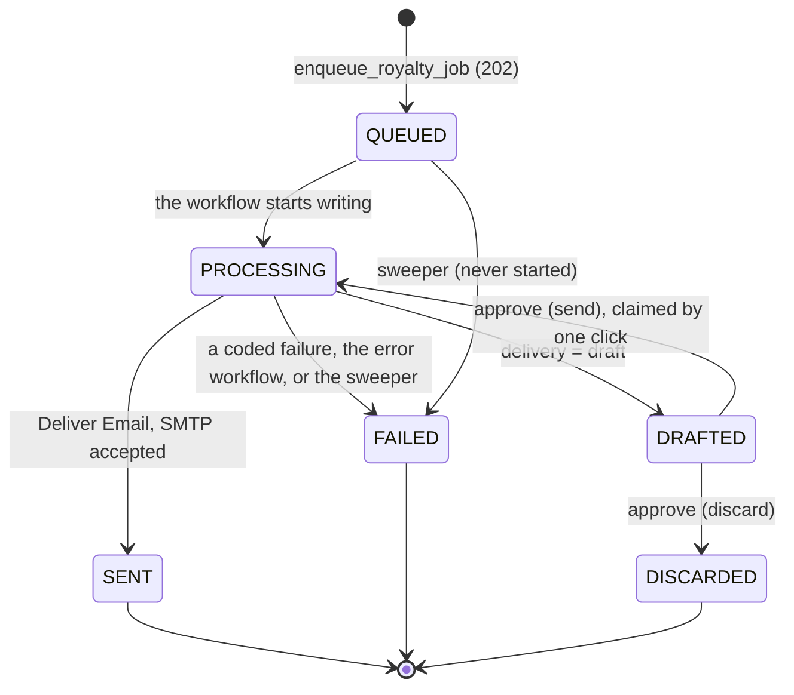
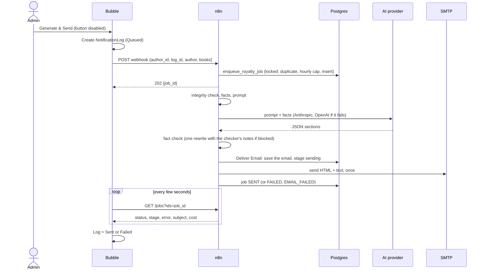
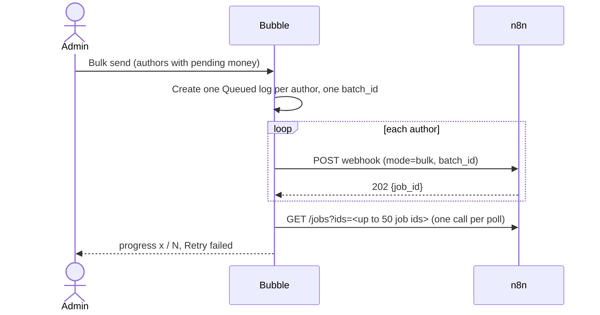

# How Bubble and n8n work together

Bubble is the app people use. n8n does the slow, risky work: check the data, call the AI, check
the result, send the email. Bubble makes every call; n8n never calls Bubble.

The exact request and response shapes are in [`n8n/PAYLOAD.md`](../n8n/PAYLOAD.md). This page
explains the flow and the reasons behind it.

## The webhook contract (summary)

- `POST /webhook/royalty-summary`, JSON body: `author_id` (Bubble id), `mode` (`single` or `bulk`),
  `log_id` (the NotificationLog row), `requested_by`, optional `reference_date`, `demo_inbox`,
  writing options (`delivery`, `tone`, `length`, `note`, `sign_off`) and `drills`, plus the author's
  data (`author`, `books`): n8n never reads Bubble's database.
- Every field is checked for type, length and format. Bad input gets **400** with a list of
  errors. A missing or wrong `X-BookLeaf-Key` gets **403** from n8n before any workflow runs.
- Success is **202 Accepted** with `{job_id, status, duplicate: false}`. The email is not sent yet:
  Bubble polls `GET /webhook/royalty-summary/jobs?ids=…` for the result.
- `delivery: "draft"` stops at a checked draft; `POST /webhook/royalty-summary/approve` then checks,
  sends or discards it.

## Job lifecycle

A retry from the admin creates a new job. It does not re-open an old one, so the history stays true.

## Single send

## Bulk send

Each author is a separate job. One failure never stops the others.

## Why Bubble polls

- Bubble's free plan has no Data API and no Workflow API: n8n can neither read Bubble data nor call
  a Bubble workflow. So Bubble sends the data with the request and asks for the result.
- Bubble's API Connector call times out at about 50 seconds. An AI email takes 10 to 30 seconds
  and can run longer with a rewrite. So the webhook answers **202 at once** and keeps the job in
  Postgres.
- On a paid Bubble plan, n8n could push each result back instead; that upgrade path is described
  in `n8n/PAYLOAD.md`. It was removed from the workflows to keep one tested path.

## Authentication

| Direction | How |
|---|---|
| Bubble to n8n | Header `X-BookLeaf-Key`. The key is stored in Bubble's API Connector marked "Private", so it is applied on Bubble's server and never reaches the browser. n8n checks it itself (Header Auth with the credential "BookLeaf Webhook Key" on all three webhooks): a missing or wrong key gets 403 and no workflow runs. |
| n8n to Bubble | None. n8n never calls Bubble. |

**Key rotation:** n8n checks one key. To rotate: put a new key in `.secrets/webhook.env`, run
`n8n/deploy.mjs` (n8n switches at once), then change the key in Bubble. Calls in between get 403,
so rotate when no one is sending.

The key is compared as a plain string, not in constant time. It does not appear in n8n's logs at
the default log level. The request headers (key included) are kept in the saved executions of
royalty-summary and approve-draft (job-status saves no successful run), which only n8n users can
open and n8n deletes after 14 days. n8n's execution-data redaction needs an Enterprise licence.

## Idempotency (a double click must not send two emails)

1. **In the UI:** the button is disabled while a send is in flight.
2. **On enqueue:** each request gets a fingerprint (a SHA-256 of everything that shapes the email).
   The Postgres function `enqueue_royalty_job` holds one advisory lock while it decides, so
   simultaneous requests are handled one at a time: the same author and fingerprint within the
   last `duplicate_window_minutes` (10, sliding) returns the first job's id (HTTP 200,
   `duplicate: true`); otherwise the hourly cap (`max_sends_per_hour`, exact) or a new job. Two
   clicks at the same moment can never both create a job. Bubble marks the extra log row `Duplicate`.
3. **On approval:** Claim Draft moves a draft to PROCESSING in one statement, so only one click
   sends it; the others get `ALREADY_SENT`.
4. **On send:** Deliver Email tries SMTP once. A second try after a lost answer could email the
   author twice, so a failure is recorded (`EMAIL_FAILED`) instead.

The fingerprint covers the author's figures and the writing options. If the data changes (a payout
is recorded), the fingerprint changes and a new email is allowed immediately.

## The job ledger

One Postgres table, `royalty_jobs` (see `infra/db/init/01-bookleaf.sql`): job id, fingerprint and the
n8n execution id that owns the job (the enqueue's, then the approval's once a draft is claimed), Bubble
log id, status and stage, error code and message, the subject and HTML, recipient, figures verified,
AI attempts, provider, model, tokens, cost, timestamps. `callback_status` is always `NOT_NEEDED`.

It is the source of truth for a send. Bubble's log is a copy for the user, refreshed by polling.
Server settings (sender, limits, models, prices, timeouts) live next to it in `bookleaf_settings`.

## The n8n workflows

| Workflow | Job |
|---|---|
| BookLeaf - Royalty Summary | The 202 webhook and the whole pipeline: intake, ledger, data and facts, AI writer, fact check, render and deliver, record. |
| BookLeaf - Deliver Email | The one place an email is sent: saves it on the job (stage `sending`), sends once, records SENT or EMAIL_FAILED. Called by Royalty Summary and Approve Draft. |
| BookLeaf - Job Status | The polled `GET /jobs`. Reads no settings and saves no successful run. |
| BookLeaf - Approve Draft | Check, send or discard a draft. |
| BookLeaf - Error Handler | Error workflow of Royalty Summary and Approve Draft: fails the job by its execution id and emails `alert_email`. |
| BookLeaf - Stuck Job Sweeper | Every minute: fails jobs not finished `stuck_job_minutes` after they started. |

The workflows are generated from `n8n/workflows-src` by `n8n/build.mjs` and deployed with
`n8n/deploy.mjs`, which creates the credentials from local secret files and publishes each workflow
(Deliver Email and the Error Handler before the workflows that name them).

**Import-ready copy.** `n8n/export/` holds the six workflows as deployed on the local n8n, written by
`node n8n/tools/export.mjs --env .secrets/n8n-local.env`. Credential ids are `null`, so
`n8n import:workflow --separate --input=n8n/export` links each node to the credential with the same
name and type on the target instance (it must exist there first; with none or two of that name the
node stays unlinked). Workflow ids are kept, so the error workflow and the Deliver Email calls still
point at the imported workflows. Imported workflows are inactive until published. A unit test checks
that the export matches the committed build and holds no secret.
