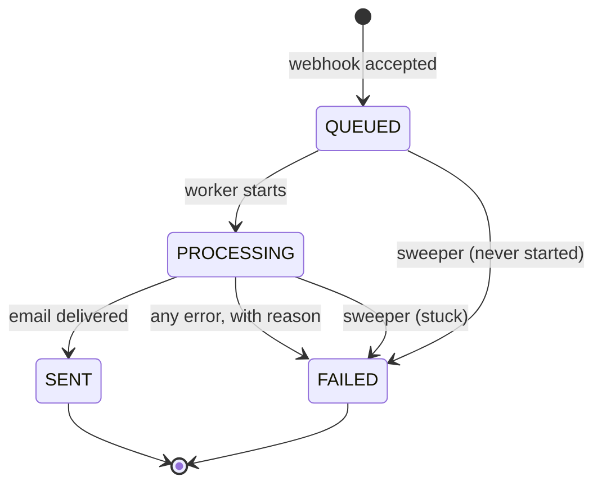
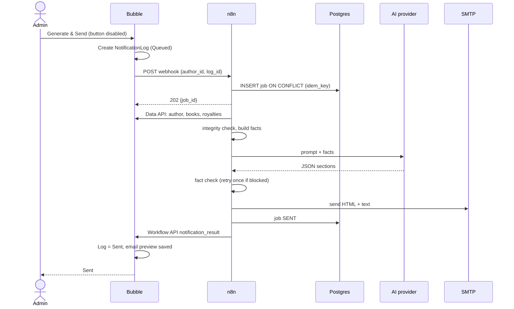
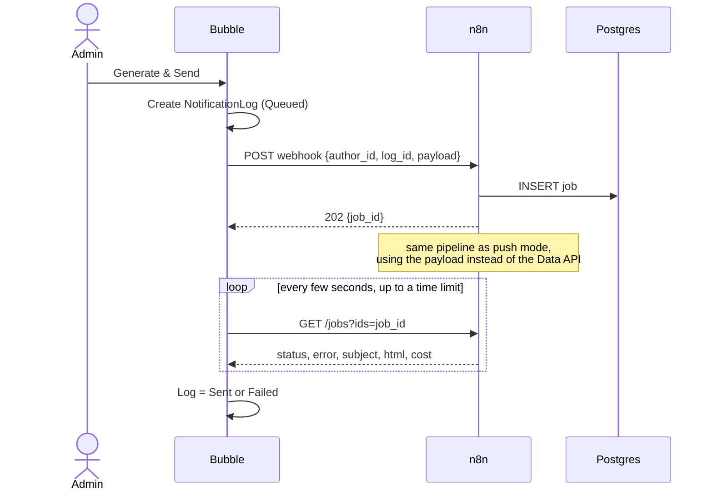
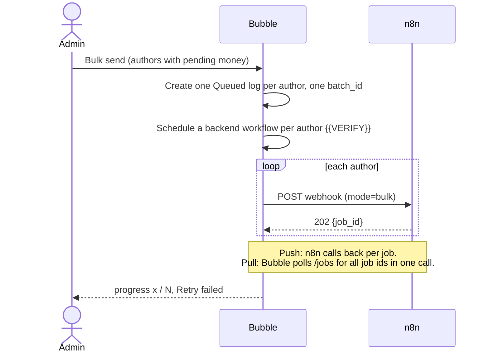

# How Bubble and n8n work together

Bubble is the app people use. n8n does the slow, risky work: fetch data, call the AI, check the
result, send the email. They talk over two HTTP calls and one status record.

The exact request and response shapes are in [`n8n/PAYLOAD.md`](../n8n/PAYLOAD.md). This page
explains the flow and the reasons behind it.

## The webhook contract (summary)

- `POST /webhook/royalty-summary`, JSON body.
- Core fields: `author_id` (Bubble id), `mode` (`single` or `bulk`), `log_id` (the
  NotificationLog row), `requested_by`, and optionally `reference_date`.
- In **pull** mode the body also carries the author's data (`payload`: author and books), because
  n8n cannot read Bubble.
- Every field is checked for type, length and format. Bad input gets **400** with a list of
  errors. A missing or wrong key gets **401**.
- Success is **202 Accepted** with a `job_id`. The email is not sent yet. The caller then
  waits for the result (push) or asks for it (pull).

## Job lifecycle

A retry from the admin creates a new job. It does not re-open an old one, so the history stays true.

## Single send, push mode (Bubble paid plan)

## Single send, pull mode (Bubble free plan)

The free plan has no incoming API, so n8n cannot call Bubble. Bubble does all the talking.

## Bulk send

Each author is a separate job. One failure never stops the others.

## Why pull mode exists

- Bubble's free plan has no app API. n8n can neither read Bubble data nor call a Bubble workflow.
- Bubble's API Connector call times out at about 50 seconds. An AI email takes 10 to 30 seconds
  and can run longer with a retry. So the webhook must not wait for the email.
- The answer to both is the same: reply **202 at once**, keep the job in a database, let
  Bubble ask for the result. Push mode is faster and simpler for the user, but pull mode keeps
  the whole product working on any Bubble plan, including after a trial ends. The mode is the
  `callback_mode` setting in Bubble, and `CALLBACK_MODE` in n8n.

## Authentication

| Direction | How |
|---|---|
| Bubble to n8n | Header `X-BookLeaf-Key`. The key is stored in Bubble's API Connector marked "Private", so it is applied on Bubble's server and never reaches the browser. |
| n8n to Bubble | A Bubble API token, held only in n8n credentials, sent as a Bearer token. |

**Key rotation:** n8n accepts two keys at once, `current` and `next`. To rotate: add `next` in
n8n, change the key in Bubble, then promote `next` to `current`. There is no downtime.

Keys are compared in constant time and never written to logs. {{VERIFY}}

## Idempotency (a double click must not send two emails)

1. **In the UI:** the button is disabled while a send is in flight.
2. **In n8n:** each job gets `idem_key = author + data fingerprint + 10-minute window`. The
   `royalty_jobs.idem_key` column has a **unique index**, and the insert is
   `INSERT ... ON CONFLICT (idem_key)`. A second request in the same window returns the first
   job's id. Bubble marks the extra log row `Duplicate`.
3. **On the callback:** applying a result is idempotent per job id, so a retried callback cannot
   change a finished log twice.

The fingerprint is a hash of the author's figures. If the data changes (a payout is recorded),
the key changes and a new email is allowed immediately.

## The job ledger

One Postgres table, `royalty_jobs` (see `infra/db/init/01-bookleaf.sql`): job id, idempotency
key, Bubble log id, status, error code and message, the subject and HTML sent, recipient,
figures verified, AI attempts, provider, model, tokens, cost, callback status, timestamps.

It is the source of truth for a send. Bubble's log is a copy for the user. If a callback fails,
the result is still in the ledger and can be delivered later.

## Callback delivery

Push mode: n8n retries the callback 3 times with growing waits. If Bubble is still down, the job
keeps `callback_status = FAILED` and the result is held. The next time Bubble asks (page load
or poll) it is reconciled. {{VERIFY}}
