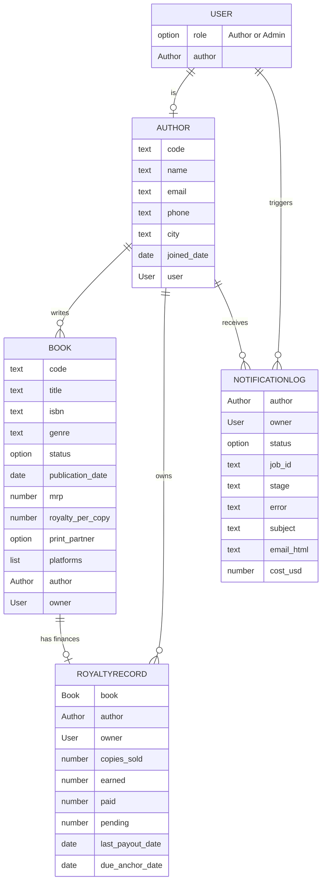

# Database schema

Bubble holds the author-facing data. Postgres (inside n8n's stack) holds the job ledger. This page
covers Bubble. The ledger is in [integration.md](integration.md). The schema is also written as data
in `bubble-app/schema.mjs`. A script, `scripts/editor/verify-schema.mjs`, compares the live Bubble
editor with that file and lists every missing, extra or wrongly typed field. It runs in a browser
against the editor (not in CI), so drift shows up whenever it is run.

## Relationships

## Data types

### User (Bubble built-in, extended)
`role` (option Role) and `author` (link to Author). One login per author, plus one admin.
Why: the role drives every privacy rule, and the link says which Author a login belongs to.

### Author
`code` (e.g. AUTH001), `name`, `email`, `phone`, `city`, `joined_date`, `user`.
Why: the people. `code` is the id from the sample data, so seeding and tests can refer to authors
without Bubble's internal ids.

### Book
`code`, `title`, `isbn`, `genre`, `status` (option), `publication_date`, `mrp`, `royalty_per_copy`,
`print_partner` (option), `platforms` (list of options), `author`, `owner`, `royalty`.
Why: the catalogue. Everything here is about the book itself and changes rarely.

### RoyaltyRecord
`book`, `author`, `owner`, `copies_sold`, `earned`, `paid`, `pending`, `last_payout_date`,
`due_anchor_date`.
Why: the money. See "Why Book and RoyaltyRecord are separate" below. `due_anchor_date` is the last
payout date, or the publication date if the book was never paid. The 90-day overdue rule counts
from it, so the badge needs no "if empty" logic on the page.

### NotificationLog
One row per send request.

| Field | Purpose |
|---|---|
| `author`, `owner` | Who the email is for. `owner` is that author's login, so an author can see their own statements. |
| `triggered_by` | The admin who pressed the button. |
| `mode`, `batch_id` | Single or bulk send; bulk sends share a batch id so progress can be counted. |
| `job_id` | Links to the row in the n8n job ledger. |
| `status` | Queued, Processing, Sent, Failed, Duplicate, Draft ready, Discarded. |
| `stage` | The live step reported by n8n (queued, reading data, writing, fact-checking, sending, then sent, drafted, failed or discarded), shown as a progress stepper. |
| `delivery`, `tone`, `length` | Send now or draft for review, and the writing options the admin chose. |
| `edit_text`, `issues` | A draft's editable text, and what the checker found in an admin's edit. |
| `error` | The reason, in plain words, when Failed. |
| `subject`, `email_html`, `sent_to` | The exact email that went out (preview in the log). |
| `figures_verified` | How many figures in the email were matched to the data. |
| `model`, `cost_usd` | Which AI model wrote it and what it cost. |
| `requested_at`, `completed_at` | Timing. |

### AppSettings
One row. `reference_date`, `use_today`, `demo_inbox`; the drill switches `drill_ai_down`,
`drill_primary_down`, `drill_email_down`, `drill_data_down`; the email defaults `email_tone`,
`email_length`, `email_note`, `sign_off`, `review_first` (draft for review instead of sending).
`callback_mode` is a leftover from the removed push mode and has no effect (decision 12 in
[decisions.md](decisions.md)).
Why: admins change these without editing the app. The reference date is explained in
[decisions.md](decisions.md). Server-side limits (duplicate window, hourly cap, models, prices)
are not here: they live in n8n's Postgres table `bookleaf_settings`, out of reach of the browser.

## Option sets
`Role` (Author, Admin) · `BookStatus` (Published & Live, In Production - Cover Design,
In Production - Typesetting) · `PrintPartner` (In-House, Repro India, Epitome Books) ·
`Platform` (Amazon India, Flipkart, BookLeaf Store, Amazon US, Amazon UK) ·
`PayoutCycle` (Q1 2025 to Q2 2027, each with a `quarter_end` and a `pay_by` date, quarter end + 45
days) · `SendStatus` (Queued, Processing, Sent, Failed, Duplicate, Draft ready, Discarded).

Why option sets: they give fixed choices, so a typo cannot create a new status. They also do
**not** count toward the free plan's 200-record cap, so they cost nothing there.

## Why Book and RoyaltyRecord are separate

- A book's facts (title, ISBN, price) are not finance data. Keeping money in its own type lets
  privacy and, later, access rules treat the two differently.
- Royalty figures change every quarter. Payout updates touch only RoyaltyRecord and never
  rewrite the catalogue.
- A book can later have more than one record (for example one per quarter). n8n already sums
  several records for one book, so this needs no change to the email logic.
- In-production books have no sales. They simply have a record of zeros, or none.

## Why `owner` is on Book, RoyaltyRecord and NotificationLog

A privacy rule such as "this book's author's user is the current user" makes Bubble follow links
on every row it checks. That is slow on lists. A direct `owner` field turns the rule into one
comparison: `owner = Current User`. It costs one extra field per row and makes the rules simple to
read and to test.

## Privacy rules

| Type | Author (logged in) | Admin |
|---|---|---|
| Author | Sees only their own row | All |
| Book | Only where `owner` = me | All |
| RoyaltyRecord | Only where `owner` = me | All |
| NotificationLog | Only where `owner` = me and status = Sent (their own statements; never a draft) | All |
| AppSettings | No access | All |
| User | Own account only | All |

Other points:
- Privacy rules run on Bubble's server, so they limit every search, not only what a page shows.
  (The Data API that could bypass a page is off on the free plan anyway.)
- n8n never reads Bubble. The admin's send workflow passes the author's data to n8n through a
  server-side API Connector call; n8n holds no Bubble credential.
- The browser end-to-end check `checkAuthor` in `tests/e2e/author-portal.mjs` (run with
  `ego-browser nodejs < tests/e2e/run-author-portal.mjs`) logs in as each of the 10 authors. It fails
  with `PRIVACY` if any other author's book title appears on the page, or if a draft or discarded
  email appears in the author's statements. It also compares the KPI totals and badges with the
  tested facts logic. Last run: 10/10 authors pass (commits 3156c5a and 0ec7080, 11 Nov 2026). It
  caught one real bug: the "Own statements" rule hid the `owner` field, so an author's statement
  search returned nothing.

## Free-plan notes

- The free plan caps an app at 200 records. The sample data is 10 authors + 18 books + up to 18
  royalty records + 11 users (10 authors and 1 admin) = at most 57 records, plus 1 AppSettings row.
  Logs are added as emails are sent, so the admin page keeps the newest 100 log entries and
  deletes older ones when it loads.
- Option sets and fields do not count toward the cap.
- Seeding was done without CSV upload. See [learning-log.md](learning-log.md).
