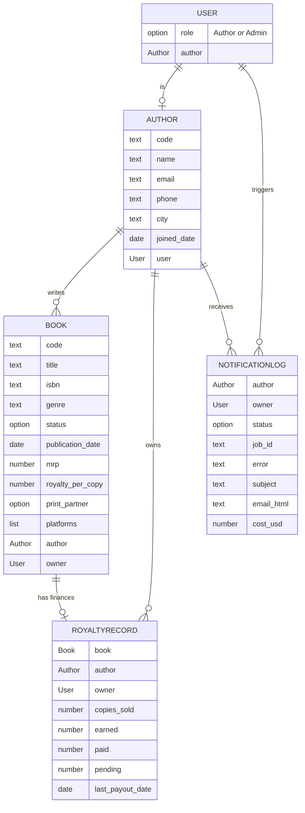

# Database schema

Bubble holds the author-facing data. Postgres (inside n8n's stack) holds the job ledger. This page
covers Bubble. The ledger is in [integration.md](integration.md). The schema is also written as data
in `bubble-app/schema.mjs`. A script, `scripts/editor/verify-schema.mjs`, compares the live Bubble
editor with that file, so the app and the file cannot drift apart without a failing check.

## Relationships

## Data types

### User (Bubble built-in, extended)
`role` (option Role) and `author` (link to Author). One login per author, plus one admin.
Why: the role drives every privacy rule, and the link says which Author a login belongs to.

### Author
`code` (e.g. AUTH001), `name`, `email`, `phone`, `city`, `joined_date`, `user`.
Why: the people. `code` is the id from the sample data, so seeding and tests can refer to authors
without Bubble's internal ids.

### Book
`code`, `title`, `isbn`, `genre`, `status` (option), `publication_date`, `mrp`, `royalty_per_copy`,
`print_partner` (option), `platforms` (list of options), `author`, `owner`, `royalty`.
Why: the catalogue. Everything here is about the book itself and changes rarely.

### RoyaltyRecord
`book`, `author`, `owner`, `copies_sold`, `earned`, `paid`, `pending`, `last_payout_date`.
Why: the money. See "Why Book and RoyaltyRecord are separate" below.

### NotificationLog
One row per send request.

| Field | Purpose |
|---|---|
| `author`, `owner` | Who the email is for. `owner` is that author's login, so an author can see their own statements. |
| `triggered_by` | The admin who pressed the button. |
| `mode`, `batch_id` | Single or bulk send; bulk sends share a batch id so progress can be counted. |
| `job_id` | Links to the row in the n8n job ledger. |
| `status` | Queued, Processing, Sent, Failed, Duplicate. |
| `error` | The reason, in plain words, when Failed. |
| `subject`, `email_html`, `sent_to` | The exact email that went out (preview in the log). |
| `figures_verified` | How many figures in the email were matched to the data. |
| `model`, `cost_usd` | Which AI model wrote it and what it cost. |
| `requested_at`, `completed_at` | Timing. |

### AppSettings
One row. `reference_date`, `use_today`, `demo_inbox`, `callback_mode` (push or pull),
`drill_ai_down`, `drill_email_down`, `drill_data_down`.
Why: admins change these without editing the app. The reference date is explained in
[decisions.md](decisions.md).

## Option sets
`Role` (Author, Admin) · `BookStatus` (Published & Live, In Production - Cover Design,
In Production - Typesetting) · `PrintPartner` (In-House, Repro India, Epitome Books) ·
`Platform` (Amazon India, Flipkart, BookLeaf Store, Amazon US, Amazon UK) ·
`SendStatus` (Queued, Processing, Sent, Failed, Duplicate).

Why option sets: they give fixed choices, so a typo cannot create a new status. They also do
**not** count toward the free plan's 200-record cap, so they cost nothing there.

## Why Book and RoyaltyRecord are separate

- A book's facts (title, ISBN, price) are not finance data. Keeping money in its own type lets
  privacy and, later, access rules treat the two differently.
- Royalty figures change every quarter. Payout updates touch only RoyaltyRecord and never
  rewrite the catalogue.
- A book can later have more than one record (for example one per quarter). n8n already sums
  several records for one book, so this needs no change to the email logic.
- In-production books have no sales. They simply have a record of zeros, or none.

## Why `owner` is on Book, RoyaltyRecord and NotificationLog

A privacy rule such as "this book's author's user is the current user" makes Bubble follow links
on every row it checks. That is slow on lists. A direct `owner` field turns the rule into one
comparison: `owner = Current User`. It costs one extra field per row and makes the rules simple to
read and to test.

## Privacy rules

| Type | Author (logged in) | Admin |
|---|---|---|
| Author | Sees only their own row | All |
| Book | Only where `owner` = me | All |
| RoyaltyRecord | Only where `owner` = me | All |
| NotificationLog | Only where `owner` = me and status = Sent (their own statements) | All |
| AppSettings | No access | All |
| User | Own account only | All |

Other points:
- Authors cannot search or list other authors' data through the Bubble API either; rules apply there too.
- n8n reads data with an admin-scoped Data API token. That token lives only in n8n credentials
  and is never in the browser or in git.
- A browser test (`tests/e2e`) logs in as author A and checks that author B's data is not visible. {{VERIFY}}

## Free-plan notes

- The free plan caps an app at 200 records. The sample data is 10 authors + 18 books + up to 18
  royalty records + 11 users = at most 57 records, so it fits. Logs are added as emails are sent.
- Option sets and fields do not count toward the cap.
- Seeding was done without CSV upload. See [learning-log.md](learning-log.md).
